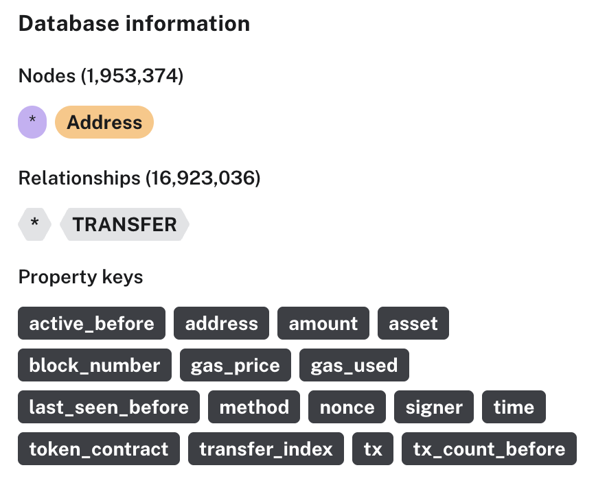

# Bybit theft graph

Public Ethereum transfers around the Bybit cold-wallet theft on 21 February 2025. The cold wallet `0x1db92e2eebc8e0c075a02bea49a2935bcd2dfcf4` was drained to `0x47666fab8bd0ac7003bce3f5c3585383f09486e2`. This repo downloads that window from BigQuery and follows the funds forward.

The download is public chain data from `bigquery-public-data.goog_blockchain_ethereum_mainnet_us`.

## How the graph is constructed

### 1. Download

Direct ETH transfers, internal ETH transfers from contract calls, and ERC-20 token transfers are pulled from `bigquery-public-data.goog_blockchain_ethereum_mainnet_us` for the window **21 Feb – 7 Mar 2025** and written to `out/raw/`.

### 2. Local graph walk (BFS)

The raw transfers are loaded into a local SQLite database (`out/graph.sqlite`). A breadth-first walk then traces funds forward from two starting points:

- **Cold wallet** `0x1db92e2eebc8e0c075a02bea49a2935bcd2dfcf4` — starting at the moment of the theft, `2025-02-21 14:13:35 UTC`
- **First receiver** `0x47666fab8bd0ac7003bce3f5c3585383f09486e2` — starting at the time it first received funds from the cold wallet

At each hop, a wallet is expanded only once, and only transfers **at or after the time it first received traced funds** are followed. This prevents backwards contamination from pre-existing activity. The walk goes up to **10 hops**.

A wallet with more than **50,000 outgoing transfers** in the window is treated as a high-volume router (e.g. a DEX or bridge contract) and is not expanded — the inbound transfer is kept, but its outgoing edges are not followed.

### 3. Enrichment

After the walk, two more BigQuery lookups add context to each node:

- **Contract flag** — whether each address is a smart contract or an EOA
- **Token metadata** — symbol, name, and decimals for each ERC-20 seen in the edges (used to convert raw integer amounts to human-readable values)

A third lookup scans the **90 days before the theft** (Nov 2024 – Feb 2025) for each reached address and records whether it was active and how many transactions it sent/received. This `active_before` flag helps distinguish purpose-built laundering wallets (freshly created) from compromised or reused ones.

### 4. Noise (optional)

`--noise` adds subgraphs from wallets unrelated to the theft, making the graph more representative of normal on-chain activity. Seeds are transfers of at least **100 ETH / stETH / mETH / cmETH / WETH** into wallets that were not already reached by the theft walk. The addresses introduced by noise are written to `out/grader_noise.csv`.

### 5. Export

The final SQLite graph is exported to three CSVs in `out/`:

| File | Contents |
|---|---|
| `nodes.csv` | One row per address: hop distance, contract flag, prior-activity stats |
| `edges.csv` | One row per transfer: amount (decimal-scaled), asset symbol, timestamp, gas info |
| `tokens.csv` | Symbol, name, decimals for every ERC-20 in the graph |

## Files

- `download_graph.py` downloads the window, walks the graph, and writes `out/`.
- `to_dump.py` writes `out/graph.dump` from the node and edge files. Neo4j Desktop can open that dump.

`out/` is generated and is not committed.

## Neo4j

`to_dump.py` loads the export into Neo4j. Addresses are nodes. A transfer is a relationship between two addresses.

We also provide a .dump file that's a snapshot of an existing Neo4j DB containing the data, hosted at the public S3 bucket: `s3://gds-public-dataset/bybit-hack-graph.dump`. You can use Neo4j's load functionality to load this .dump into your DB.



## Run

```bash
pip install google-cloud-bigquery
gcloud auth application-default login
python3 download_graph.py --project YOUR_PROJECT_ID
python3 download_graph.py --noise
python3 to_dump.py
```

`--project` is the Google Cloud project that runs the query. The script stops before a query would pass a 900 GiB cap. A later run skips tables already saved under `out/raw/` and keeps the graph when `out/graph.sqlite` and `out/edges.csv` already exist. `--rebuild-graph` loads the raw files again and walks from the cold wallet.

`--noise` does not call BigQuery. It reads `out/graph.sqlite`.

`to_dump.py` needs Neo4j Desktop installed.